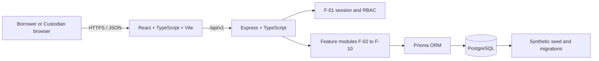
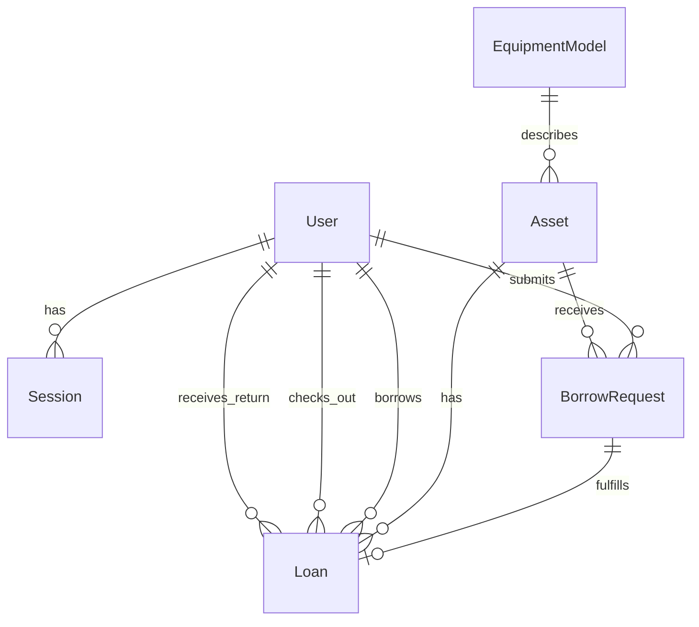

# BorrowBase System-Level Software Design Specification

## 1. System overview

BorrowBase is a browser-based equipment inventory and borrowing system for a hypothetical KMUTT Computer Engineering Department lending service. It uses synthetic users, equipment and transactions. The system boundary is:

```text
Browser UI  ->  Node.js/Express application  ->  Prisma  ->  PostgreSQL
```

The system provides persistent, access-controlled records for equipment discovery, borrowing requests, checkout, returns, history and inventory reporting. It does not integrate with real KMUTT accounts or inventory systems.

The two application actors are:

| Actor | Responsibilities | Access boundary |
|---|---|---|
| Borrower | Authenticate, view equipment, submit requests, and view own requests and active loans | Own protected records only; cannot checkout equipment, maintain inventory or view department reports |
| Custodian | Authenticate, manage department borrowing operations, checkout and return equipment, maintain inventory and view reports | Department-wide operational records; no multi-department tenancy |

An `EquipmentModel` describes a type of equipment. Each physical `Asset` has a unique asset code. A `BorrowRequest` records a Borrower's intent and does not reserve an Asset. A `Loan` records an actual checkout. Availability is derived from serviceability and active-loan state.

Sprint scope is allocated as follows:

- Sprint 1: authentication/RBAC, catalog and availability, Borrower requests and own active records, and Custodian checkout.
- Sprint 2: returns, due dates/overdue behavior, inventory administration and catalog search.
- Sprint 3: completed-loan history, inventory reporting and cross-feature hardening.

Real-account integration, public registration, payments, fines, multi-department tenancy, procurement, scanning hardware, automated notifications and complex external analytics are outside the system boundary.

## 2. System architecture

### 2.1 Technology layers

| Layer | Technology | Responsibility |
|---|---|---|
| Presentation | React, TypeScript, Vite | Authentication screens, role-aware navigation, catalog and borrowing workflows, validation feedback and responsive accessible UI |
| Application/API | Node.js, Express, TypeScript | HTTP routing, session authentication, Origin/CSRF checks, role guards, input validation, domain orchestration and safe error responses |
| Data access | Prisma ORM | Typed queries, transactions, explicit DTO projections and database access boundaries |
| Persistence | PostgreSQL | Durable entities, relationships, indexes, foreign keys, check constraints, partial unique indexes and transactional concurrency control |
| Verification | Vitest, Supertest, React Testing Library | Unit/API behavior, real PostgreSQL integration, database integrity and UI state verification |

The frontend communicates with the backend through `/api/v1` requests. The Vite development server proxies `/api` to the backend. The backend derives identity from the authenticated session and never treats client-supplied user IDs or roles as authority.

Business rules are enforced in the backend and, where appropriate, the database. Ownership predicates are part of database queries, not only UI filtering. Database constraints protect identities and relationships even when independent writers access PostgreSQL.



The diagram shows logical boundaries. It does not imply that every feature module or cloud deployment component is already implemented.

### 2.2 Responsibility boundaries

- The UI presents server data, submits validated user intent and exposes loading, empty, success and failure states. It is not an authorization boundary.
- The API authenticates every protected request, validates input, applies role and ownership rules, and coordinates domain transactions.
- PostgreSQL persists authoritative state and enforces relational and concurrency invariants.
- Feature modules use the shared F-01 guards and SYS-01 schema rather than duplicating authentication or domain models.

## 3. Major system modules

The feature inventory is authoritative for names, responsibilities, dependencies and sprint allocation.

| Module | Responsibility and primary interfaces | Status and dependencies |
|---|---|---|
| F-01 Authentication and RBAC | Login, current identity, logout, database-backed sessions, active-account checks, Origin/CSRF protection and backend role guards | Implemented for Sprint 1; uses SYS-01 `User` and `Session`; supports all protected modules |
| F-02 Equipment Catalog | List/detail views for physical Assets, model/category information, serviceability and computed availability | Sprint 1 catalog work; depends on F-01 and SYS-01; provides the selected-Asset interface consumed by F-03 |
| F-03 Borrowing Requests and Own Records | Create eligible `PENDING` requests and retrieve only the authenticated Borrower's requests and active Loans | Implemented in the F-03 feature work; depends on F-01, F-02's selected-Asset interface and SYS-01; F-04 supplies real checked-out Loans |
| F-04 Custodian Checkout | Custodian request/loan queue, exclusive checkout, atomic fulfillment and department active-loan retrieval | Sprint 1 integration work; depends on F-01, F-02, F-03 request creation and SYS-01; requires the shared Asset-lock convention |
| F-05 Returns | Record returns and recompute availability from serviceability and active-loan state | Sprint 2 planned; depends on F-04 and SYS-01 |
| F-06 Due/Overdue Management | Due-date policy, overdue calculation and upgrade/backfill of Sprint 1 Loans | Sprint 2 planned; depends on F-04 and the agreed Q-03 policy |
| F-07 Inventory Administration | Custodian maintenance of models, Assets, serviceability and historical references | Sprint 2 planned; depends on F-01, F-02, F-04 and SYS-01 |
| F-08 Catalog Search | Search and filtering by asset code, model, category and availability | Sprint 2 planned; depends on F-01, F-02 and query policy Q-04 |
| F-09 Borrowing History | Authorized completed-loan history for Borrowers and Custodians | Sprint 3 planned; depends on F-05, F-06 and SYS-01 |
| F-10 Reporting | Custodian inventory, active-loan and overdue summaries from persisted state | Sprint 3 planned; depends on F-05, F-06, F-07 and reporting policy Q-04 |

SYS-01 is the shared database foundation. SYS-02 covers verification and delivery quality across increments; it is not an additional user-facing feature.

## 4. Data architecture

### 4.1 Entities and relationships

The implemented Prisma schema contains the following entities:

| Entity | Important fields and purpose |
|---|---|
| `User` | `id`, normalized unique email, display name, Argon2id password hash, `role`, `isActive`, timestamps; owns sessions, requests and borrower loans |
| `Session` | Opaque token hash, user reference, creation/expiry/revocation timestamps; supports server-side authentication and logout |
| `EquipmentModel` | Unique `(name, category)` equipment type with optional description; has many Assets |
| `Asset` | Physical unit identity, unique `assetCode`, model reference and `serviceability` (`SERVICEABLE`, `MAINTENANCE`, `RETIRED`) |
| `BorrowRequest` | Borrower and Asset references, `status` (`PENDING` or `FULFILLED`), creation time and optional fulfillment time |
| `Loan` | Checkout record linking a BorrowRequest, Asset, Borrower and checking-out Custodian, with checkout and optional return information |



`Loan` uses a composite foreign key to `(BorrowRequest.id, BorrowRequest.borrowerId, BorrowRequest.assetId)`, so the Loan's borrower and Asset must match its request. It also has separate foreign keys to the Asset, Borrower, checkout Custodian and optional return Custodian.

### 4.2 Integrity and availability rules

- An Asset is one physical unit with a unique nonblank `assetCode`.
- A BorrowRequest belongs to one User and one Asset through foreign keys.
- A Loan belongs to one BorrowRequest and must preserve the request's Borrower/Asset pair.
- `Loan_one_active_per_asset` is a PostgreSQL partial unique index on `Loan.assetId` where `returnedAt IS NULL`; it enforces at most one active Loan per Asset.
- `BorrowRequest_one_pending_per_borrower_asset` is the F-03 partial unique index on `(borrowerId, assetId)` where `status = 'PENDING'`. It permits a later request after fulfillment while rejecting same-Borrower pending duplicates.
- A BorrowRequest in `PENDING` state has no fulfillment time; a `FULFILLED` request has one, enforced by a check constraint.
- An Asset is borrowing-available only when `serviceability = SERVICEABLE` and no active Loan exists.
- PENDING requests do not reserve Assets and do not change Asset or Loan state.
- `RESTRICT` foreign keys preserve referenced equipment, requests and users needed for history.

The base SYS-01 migration creates the schema, foreign keys, ordinary indexes, checks and `Loan_one_active_per_asset`. The dedicated F-03 migration adds the pending-request partial unique index without changing the historical SYS-01 migration.

### 4.3 Local database lifecycle

Local development uses PostgreSQL, Prisma migrations and synthetic seed data:

```bash
cp .env.example .env
cp backend/.env.example backend/.env
npm ci
npm run db:generate
npm run db:migrate
npm run db:seed
```

`DATABASE_URL` points to the local database. The seed requires synthetic `SEED_BORROWER_PASSWORD` and `SEED_CUSTODIAN_PASSWORD` values and creates `borrower@example.test`, `custodian@example.test` and synthetic equipment fixtures. Database tests use separately named disposable databases and never reset a running application database.

## 5. UI architecture

The authenticated application shell contains the BorrowBase header, session bootstrap, current-role identity, sign-out action and role-specific workspace. Protected content is not rendered until `/api/v1/auth/me` resolves.

### Existing and planned navigation

| UI area | Design |
|---|---|
| Authentication | Labeled login form with masked password, pending state, generic credential errors and retryable connection errors |
| Borrower navigation | F-03 provides My Requests and My Active Loans, request/detail views and the selected-Asset request panel |
| Custodian navigation | F-04 will provide department request/active-loan queue and checkout views; later modules add returns, administration and reporting |
| Equipment Catalog | F-02 provides model/Asset list and detail views with serviceability and computed availability; it invokes F-03 through the selected physical Asset ID |
| Future operations | F-05 through F-10 add returns, due/overdue, inventory, search, history and reporting screens in later sprints |

Shared UI conventions use Indigo `#4F46E5`, Sky Blue `#87CEFA`, Slate `#475569` and Off-White `#F8FAFC`. Screens provide explicit loading, empty, success and failure states, visible focus, labeled controls, keyboard operation and responsive layouts from mobile to desktop. Error states do not present uncertain mutations as successful.

The UI hides controls that are not relevant to the current role for usability, but backend guards remain the authorization boundary.

## 6. API architecture

### 6.1 Conventions

Protected resources use the `/api/v1` prefix and JSON request/response bodies. Successful JSON responses use a `data` envelope; the documented logout operation is the exception and returns `204 No Content`. Errors use:

```json
{
  "error": {
    "code": "ERROR_CODE",
    "message": "Safe user-facing message",
    "requestId": "..."
  }
}
```

The backend assigns a request ID, disables cache storage for application responses and uses a centralized error handler. Validation errors, authorization failures, conflicts and server failures have explicit status codes. Unexpected database details are not returned.

### 6.2 Implemented examples

F-01 provides:

- `POST /api/v1/auth/login`
- `GET /api/v1/auth/me`
- `POST /api/v1/auth/logout`

F-03 provides:

- `POST /api/v1/borrow-requests`
- `GET /api/v1/me/borrow-requests`
- `GET /api/v1/me/borrow-requests/:id`
- `GET /api/v1/me/loans`
- `GET /api/v1/me/loans/:id`

F-03 request DTOs explicitly project request/loan identity, timestamps and Asset model information. It does not expose password hashes, session hashes, email addresses or another Borrower's identity.

### 6.3 Request processing

Protected requests authenticate first, then apply the required role. POST mutations additionally require the exact configured Origin, a valid session-bound CSRF token, JSON content type and strict body validation. F-03 accepts only `{ "assetId": "<uuid>" }`; the server obtains the borrower from session context.

F-03 creation locks the selected Asset inside a Prisma transaction, rechecks serviceability and active-loan state, checks the pending-request rule and creates the request. F-04 must use the same Asset-first lock ordering for checkout. F-02 and F-04 endpoint details remain in their feature contracts until implemented.

## 7. Security and access control

F-01 uses Argon2id password hashes and opaque, cryptographically random session tokens. Only a SHA-256 token hash is stored in `Session`. The raw token is held in an HttpOnly, SameSite=Lax cookie and is never placed in local storage, JSON responses or logs. Secure cookies are enabled for production HTTPS.

Authentication resolves the current Session and User from PostgreSQL for every protected request. Expired, revoked or inactive-user sessions return 401. Logout revokes the current session and clears the cookie. The configured absolute session lifetime is eight hours.

Login and logout use exact Origin validation. Protected mutations additionally use a CSRF value derived from the session token hash and backend-only `CSRF_SECRET`, compared with constant-time validation. Login attempts use a local per-identifier/IP limiter; distributed production protection remains a deployment consideration.

Role and ownership checks are enforced in Express middleware and database predicates:

| Operation | Borrower | Custodian |
|---|---:|---:|
| Authenticate and view own identity | Yes | Yes |
| Browse catalog | Yes | Yes |
| Create a BorrowRequest | Yes | No |
| Read own requests and active Loans | Yes | No |
| Read department request/loan queue | No | F-04 |
| Checkout or return equipment | No | F-04/F-05 |
| Maintain inventory | No | F-07 |
| View department reports | No | F-10 |

Foreign owner details are concealed as not found. Lists filter by authenticated ownership before projection. Invalid input, conflicts and persistence failures return safe responses without stack traces, SQL, credentials or other private data.

## 8. Configuration and deployment design

### 8.1 Local configuration

The backend requires:

- `DATABASE_URL` for PostgreSQL.
- `NODE_ENV` (`development`, `test` or `production`).
- `PORT`.
- Exact `APP_ORIGIN`.
- `CSRF_SECRET` with at least 32 bytes of entropy.

The root environment also supplies synthetic seed passwords. Environment files are ignored and must never contain committed credentials. Prisma CLI commands and the backend use the configured database URL; migrations and seeding are explicit operations rather than application-startup side effects.

Build and runtime are separate: TypeScript is checked and the backend build emits compiled artifacts through `tsconfig.build.json`; the current development script runs `src/server.ts` with Node's watch mode. The frontend build runs TypeScript checking and emits a Vite static artifact. A production process/container start command remains deployment work.

### 8.2 Planned packaging and cloud deployment

Container packaging and GCP deployment are planned delivery work, not implemented in the current repository. The intended deployment separation is:

```text
Browser
  -> HTTPS frontend static hosting/container
  -> HTTPS Node.js API service
  -> private/durable PostgreSQL service
```

A future GCP design may use a managed container runtime such as Cloud Run for the frontend/API and Cloud SQL for PostgreSQL; these are candidate services, not deployed resources in this deliverable. The deployment design must provide:

- durable PostgreSQL storage and backups;
- secret injection for `DATABASE_URL`, `CSRF_SECRET` and seed/deployment credentials;
- HTTPS and an exact production `APP_ORIGIN`;
- controlled Prisma migration execution before application rollout;
- separate development, test and production databases;
- health, logging and rollback procedures that do not expose credentials or session tokens.

No Docker image, GCP project, Cloud Run service, Cloud SQL instance or production deployment is claimed as existing.

## 9. Architectural decisions and dependencies

1. `EquipmentModel` describes a type; `Asset` identifies one physical unit. Availability is computed, not stored as a mutable availability flag.
2. `BorrowRequest` expresses intent; `Loan` records actual checkout. A pending request never reserves an Asset.
3. F-01 derives identity and role from a database-backed session. Client-supplied borrower IDs and roles are not authoritative.
4. Ownership is enforced in backend queries and response projections, not by hidden UI controls.
5. PostgreSQL constraints preserve unique user/asset identities, request/loan relationships, one active Loan per Asset and one pending request per Borrower/Asset pair.
6. Request creation and future checkout use transactions and lock the Asset first. F-04 must preserve this ordering and atomically transition the selected request, create the Loan and enforce active-loan exclusivity.
7. F-02 supplies selected physical Asset identity to F-03. F-04 consumes PENDING requests and supplies the real checkout-created Loans retrieved by F-03.
8. Q-02 policy: when F-04 fulfills one request and creates a Loan, competing requests remain `PENDING`. This is the chosen Sprint 1 integration policy and remains pending Member 2 acknowledgement; it is not an already confirmed teammate agreement.
9. F-05 through F-10 depend on the shared schema and the state transitions established by F-03/F-04. Due-date, history and reporting behavior must not be inferred from Sprint 1 active-loan retrieval.
